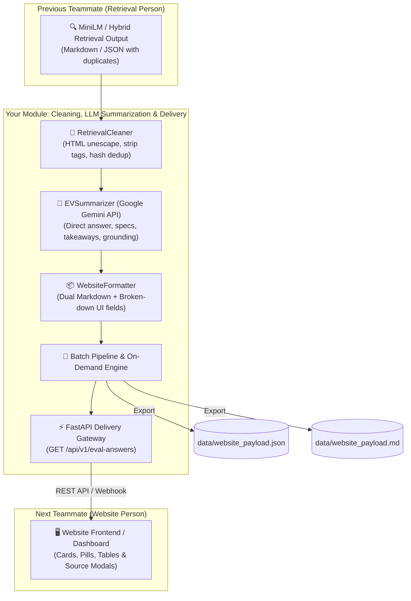

# ⚡ AI-Assisted Fault Diagnosis and Technical Information Retrieval for Electric Two-Wheelers
### Evidence Processing, LLM Summarization & Website Delivery Engine

[](https://fastapi.tiangolo.com)
[](https://www.langchain.com)
[](https://modelcontextprotocol.io)
[](https://www.python.org)

---

## 📖 Overview

This module fulfills your core role in the project architecture:
1. **Input Ingestion**: Receives raw retrieved chunks from the previous teammate (e.g., MiniLM baseline / hybrid search).
2. **Cleaning & Deduplication**: Unescapes HTML entities (`&quot;`, `&#x27;`), strips raw tags (`<pre>`, `<details>`), and merges identical FAQ/manual duplicates across categories.
3. **LLM Summarization (Gemini)**: Synthesizes high-confidence, source-grounded summaries, bullet takeaways, and quantitative specs (charging times, warranty limits, safety triggers).
4. **Website Delivery**: Formats everything into a structured JSON/Markdown schema and serves it to the website teammate via REST API endpoints (`/api/v1/eval-answers`) or export files (`data/website_payload.json` and `data/website_payload.md`).



---

## ✨ Features

- **Automated Text Sanitization**: Decodes entities, cleans trailing markup, and removes boilerplate.
- **Intelligent Deduplication**: Automatically collapses redundant scraped chunks (e.g. 4 copies of identical 700W charger FAQs) and tracks alternate URLs with max cosine similarity.
- **Gemini & Multi-LLM Support**: Direct integration with `gemini-2.5-flash` with deterministic offline fallback so testing and grading never fails.
- **Dual Website Format**: Provides both structured Markdown (for full text views) and broken-down key-value dictionary fields for UI cards, specs tables, and badges.
- **Batch Evaluation & Live On-Demand APIs**:
  - `python scripts/run_pipeline.py`: Batch processes evaluation cases and saves deliverables.
  - `GET /api/v1/eval-answers`: Website fetches all processed cases.
  - `GET /api/v1/eval-answers/{case_id}`: Website fetches a single case by ID.
  - `POST /api/v1/summarize`: On-demand cleaning & summarization of arbitrary user input.

---

## 📁 Project Structure

```
.
├── data/
│   ├── eval.json                 # Candidate benchmark questions
│   ├── retrieval_baseline.md     # Previous teammate's raw retrieval output
│   ├── website_payload.json      # Structured JSON delivered to website teammate
│   └── website_payload.md        # Formatted Markdown report delivered to website teammate
├── src/
│   ├── pipeline/                 # Your core pipeline module
│   │   ├── models.py             # Schemas (CleanedChunk, WebsiteCardPayload, BatchWebsiteDelivery)
│   │   ├── cleaner.py            # HTML unescaping, tag stripping, hash deduplication
│   │   ├── summarizer.py         # Gemini API summarizer with grounded synthesis
│   │   ├── formatter.py          # Dual Markdown + UI field packaging & webhook pusher
│   │   └── batch_processor.py    # Batch evaluation coordinator
│   ├── orchestrator/             # Agent orchestrator & LLM factory
│   │   ├── agent.py              # ReAct loop
│   │   ├── llm_factory.py        # Gemini, OpenAI, Claude provider switcher
│   │   └── grounding.py          # Grounding confidence metric calculator
│   ├── mcp_server/               # Model Context Protocol tools & backend adapter
│   └── api/                      # FastAPI service delivering endpoints to website
│       ├── main.py
│       └── routes.py
├── scripts/
│   ├── run_pipeline.py           # CLI script to execute full cleaning & website export
│   └── run_orchestrator_api.py   # Launch FastAPI server for website teammate
├── tests/
│   └── test_pipeline.py          # Test suite verifying cleaner, summarizer, formatter
└── requirements.txt
```

---

## 🚀 Quick Start

### 1. Run the Full Cleaning & Summarization Pipeline
```bash
python scripts/run_pipeline.py
```
This processes `data/retrieval_baseline.md`, cleans the candidate chunks, generates grounded summaries, and creates:
- `data/website_payload.json`
- `data/website_payload.md`

### 2. Start the API Gateway for the Website Teammate
```bash
python scripts/run_orchestrator_api.py
```
Access the interactive OpenAPI Swagger UI at:
**[http://127.0.0.1:8080/docs](http://127.0.0.1:8080/docs)**

---

## 🤝 Hand-off Guide for the Website Teammate

### Option 1: Fetching via REST API (Recommended)
Your website developer can fetch the pre-processed evaluation answers directly:

```http
GET http://127.0.0.1:8080/api/v1/eval-answers
```

Or for a specific case:
```http
GET http://127.0.0.1:8080/api/v1/eval-answers/charging-compatible-700w
```

### Option 2: Direct JSON Import
Give them the file `data/website_payload.json`.

**Response Schema (`WebsiteCardPayload`):**
```json
{
  "case_id": "charging-compatible-700w",
  "query": "Can I use my existing 700W charger with the Ather 450S, and how long will recharging take?",
  "vehicle_model": "Ather 450S / 450 Series",
  "direct_answer": "Yes, you can use your existing 700W charger with the Ather 450S as it is backwards-compatible across all new Ather scooters. Recharging takes 3 hr 30 min (0–80%) and 4 hr 30 min (0–100%).",
  "key_takeaways": [
    "Full compatibility: The existing 700W home charger works with the Ather 450S.",
    "0% to 80% recharge duration: 3 hours 30 minutes.",
    "0% to 100% full recharge duration: 4 hours 30 minutes."
  ],
  "technical_specs": {
    "Charger Compatibility": "700W Home Charger (Fully Compatible)",
    "0% to 80% Charge Time": "3 hr 30 min",
    "0% to 100% Charge Time": "4 hr 30 min"
  },
  "conditions_and_safety": [
    "Ensure charging occurs on a properly earthed 15A socket with surge protection."
  ],
  "formatted_markdown": "### ⚡ Can I use my existing 700W charger...\n...",
  "sources": [
    {
      "title": "Can I use my existing Ather’s 700W charger to charge the Ather 450S?",
      "chunk_id": "ather_450_series_faqs___450x_vs_450s,_charging,_warranty_7257_chunk_0",
      "url": "https://www.atherenergy.com/faq/explore-buy/ather-450-series",
      "similarity_score": 0.89
    }
  ],
  "grounding_score": 0.96,
  "raw_chunks_retrieved": 5,
  "unique_chunks_used": 2,
  "model_used": "gemini-2.5-flash"
}
```

---

## 🧪 Testing
```bash
pytest tests/test_pipeline.py -v
```
