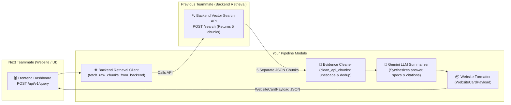

# ⚡ AI-Assisted Fault Diagnosis and Technical Information Retrieval for Electric Two-Wheelers
### Evidence Processing, LLM Summarization & Website Delivery Engine

[](https://fastapi.tiangolo.com)
[](https://www.langchain.com)
[](https://modelcontextprotocol.io)
[](https://www.python.org)

---

## 📖 Overview & Your Role

This module acts as the **bridge between the Backend Retrieval Layer and the Website Frontend**:
1. **Live Backend Integration**: Calls the Backend API (vector search) to retrieve $N$ candidate technical documentation chunks (default: 5 separate chunks).
2. **Text Cleaning & Deduplication**: Unescapes HTML entities (`&quot;`, `&#x27;`), strips markup tags, normalizes whitespace, and deduplicates redundant FAQ/manual chunks while preserving the highest similarity scores and citation links.
3. **LLM Reasoning & Summarization (Gemini)**: Uses Google Gemini (`gemini-2.5-flash`) to generate structured, source-grounded answers with quantitative specifications (charging times, voltages, warranty limits), safety precautions, and key bullet takeaways.
4. **Website Delivery Contract**: Packages the output into a dual format (rich Markdown for reading views + broken-down JSON fields for UI cards and specification tables) served via FastAPI.



---

## 📦 Chunk Data Contract (Input from Backend API)

The backend retrieval API returns **5 separate chunks** matching the following JSON schema:

```json
{
  "chunk_id": "2025-450S-QSG_page_1_chunk_0",
  "record_id": "2025-450S-QSG_page_1",
  "source_document": "2025-450S-QSG",
  "source_type": "official",
  "content_type": "pdf",
  "title": "2025-450S-QSG",
  "text": "Q U I C K S TA R T G U I D E - 700W charger is backwards compatible with Ather 450S. Recharging from 0-80% takes 3 hr 30 min...",
  "score": 0.8900,
  "provenance": {
    "document_id": "2025-450S-QSG",
    "url": "https://media.atherenergy.com/2025-450S-QSG.pdf",
    "source_type": "official",
    "document_type": "quick_start_guide",
    "manufacturer": "Ather Energy",
    "vehicle_model": "Ather 450S",
    "retrieved_at": "2026-10-26T07:21:12.151865+00:00"
  },
  "metadata": {
    "category": "charging-grid",
    "group": "Ather 450 Series",
    "page": 1
  }
}
```

---

## 🌐 Website Data Contract (Output Delivered to Frontend)

The website teammate receives a clean `WebsiteCardPayload` object tailored for frontend rendering:

```json
{
  "case_id": "live-a1b2c3d4",
  "query": "Can I use my existing 700W charger with the Ather 450S, and how long will recharging take?",
  "vehicle_model": "Ather 450S",
  "direct_answer": "Yes, you can use your existing 700W charger with the Ather 450S as it is backwards-compatible across all new Ather scooters. Recharging takes 3 hr 30 min (0–80%) and 4 hr 30 min (0–100%).",
  "key_takeaways": [
    "Full compatibility: The existing 700W home charger works with the Ather 450S.",
    "0% to 80% recharge duration: 3 hours 30 minutes.",
    "0% to 100% full recharge duration: 4 hours 30 minutes."
  ],
  "technical_specs": {
    "Charger Compatibility": "700W Home Charger (Fully Compatible)",
    "0% to 80% Charge Time": "3 hr 30 min",
    "0% to 100% Charge Time": "4 hr 30 min"
  },
  "conditions_and_safety": [
    "Ensure charging occurs on a properly earthed 15A socket with surge protection."
  ],
  "formatted_markdown": "### ⚡ Can I use my existing 700W charger...\n...",
  "sources": [
    {
      "title": "2025-450S-QSG",
      "chunk_id": "2025-450S-QSG_page_1_chunk_0",
      "url": "https://media.atherenergy.com/2025-450S-QSG.pdf",
      "similarity_score": 0.8900
    }
  ],
  "grounding_score": 0.96,
  "raw_chunks_retrieved": 5,
  "unique_chunks_used": 2,
  "model_used": "gemini-2.5-flash"
}
```

---

## 🔌 API Endpoints for Your Teammates

Start the API server:
```bash
python scripts/run_orchestrator_api.py
```
Interactive Swagger OpenAPI documentation is available at: **[http://127.0.0.1:8080/docs](http://127.0.0.1:8080/docs)**.

### 1. For the Website Teammate (Live Query)
Send a query from your frontend:
```http
POST /api/v1/query
Content-Type: application/json

{
  "query": "What home charging time is listed for the Ather 450S?",
  "vehicle_model": "Ather 450S",
  "top_k": 5
}
```
* **What happens:** The API calls the backend retrieval layer, fetches 5 chunks, cleans them, prompts Gemini for a grounded summary, and returns the full `WebsiteCardPayload` JSON above.

### 2. For the Backend Teammate (Direct Chunks Processing)
If the backend teammate wants to pass the 5 chunks directly to test cleaning & summarization without an extra network hop:
```http
POST /api/v1/process-chunks
Content-Type: application/json

{
  "query": "Can I use my 700W charger?",
  "chunks": [
    {
      "chunk_id": "2025-450S-QSG_page_1_chunk_0",
      "text": "...",
      "title": "2025-450S-QSG",
      "provenance": { "url": "https://media.atherenergy.com/2025-450S-QSG.pdf" }
    }
  ]
}
```

### 3. For Offline / Benchmark Evaluation
* `GET /api/v1/eval-answers`: Delivers pre-computed batch answers for the benchmark questions in `data/eval.json`.
* `GET /api/v1/eval-answers/{case_id}`: Fetches a specific evaluation case by ID.

---

## ⚙️ Configuration for the Backend Teammate

In `.env`:
```env
# Backend Hybrid Retrieval API (Teammate's Component)
HYBRID_RETRIEVAL_USE_MOCK=false
HYBRID_RETRIEVAL_API_BASE_URL=http://localhost:8000
HYBRID_RETRIEVAL_API_KEY=
```

To adjust the endpoint path or request structure, edit lines 295–345 in [`src/mcp_server/backend_adapter.py`](file:///C:/Users/abhay/Desktop/Projects/EV%20Fault%20Diagnois_Local/src/mcp_server/backend_adapter.py).

---

## 📁 Project Structure

```
.
├── config/
│   ├── settings.py               # Pydantic Settings (.env loader)
│   └── mcp_servers.json          # MCP server profiles
├── data/
│   ├── eval.json                 # Benchmark candidate questions
│   ├── retrieval_baseline.md     # Offline retrieval baseline
│   ├── website_payload.json      # Pre-generated batch website JSON
│   └── website_payload.md        # Formatted Markdown report
├── src/
│   ├── pipeline/                 # Core Evidence Processing & Delivery
│   │   ├── models.py             # CleanedChunk, WebsiteCardPayload, BatchWebsiteDelivery
│   │   ├── cleaner.py            # HTML entity decoding, whitespace cleanup, deduplication
│   │   ├── summarizer.py         # Gemini LLM summarizer with grounding checks
│   │   ├── formatter.py          # Markdown generator & website payload packaging
│   │   ├── service.py            # Live query orchestrator (Backend API -> Cleaner -> Gemini)
│   │   └── batch_processor.py    # Offline benchmark evaluation runner
│   ├── mcp_server/
│   │   ├── backend_adapter.py    # Backend Retrieval Client (fetch_raw_chunks_from_backend)
│   │   ├── server.py             # FastMCP / MCPServer (SSE & Stdio transports)
│   │   └── tools.py              # MCP diagnostic tools
│   ├── orchestrator/             # ReAct reasoning loop & LLM factory
│   │   ├── agent.py
│   │   ├── llm_factory.py        # Gemini, OpenAI, Claude switcher
│   │   └── grounding.py          # Grounding score formula
│   └── api/
│       ├── main.py               # FastAPI application setup with CORS
│       └── routes.py             # REST routes (/query, /process-chunks, /eval-answers)
├── scripts/
│   ├── run_pipeline.py           # CLI script to run batch evaluation
│   ├── run_orchestrator_api.py   # Launch FastAPI server
│   └── demo_cli.py               # Interactive CLI diagnostic demo
├── tests/
│   ├── test_api_chunks.py        # Tests for live chunk cleaning & endpoints
│   ├── test_pipeline.py          # Tests for cleaner, summarizer, formatter
│   └── test_api.py               # Integration tests
└── requirements.txt
```

---

## 🧪 Running the Tests

To run the complete automated test suite:
```bash
pytest tests
```
*(Runs 15 unit and integration tests verifying chunk cleaning, deduplication, Gemini summarization, and FastAPI routes).*
