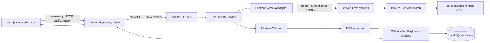

# EV Fault Diagnosis RAG

The repository connects a Next.js website, a FastAPI backend/retrieval service, and a FastAPI agent pipeline. The website query path retrieves evidence, cleans it, creates a structured answer, and saves the result in local SQLite history.

## Project status

The retrieval-first website flow, local diagnosis history, Gemini synthesis support, and query-driven Knowledge Base are implemented on `feature/retrieval-first-website-integration`. The changes are pushed to [PR #3](https://github.com/darklord241/ev-fault-diagnosis-rag/pull/3), which targets `full-integration`; they are not yet merged into that branch.

The app can run in demo mode without a corpus or API key. Live retrieval requires the locally supplied chunk corpus and matching embedding cache (or the ability to build the cache with the local embedding model). Gemini is optional and is used only for answer synthesis; without a working provider, the pipeline uses its labeled deterministic fallback. Query history is stored on the local machine in SQLite. Hosting and a shared/production database are not configured.

### Changes covered by this integration

- Connected the website's main diagnosis form to the retrieval-first `/api/v1/query` pipeline through the backend gateway and agent API.
- Added authenticated calls from the agent to the scraper's vector-search implementation, including vehicle/subsystem filtering before top-k ranking.
- Added top-five Knowledge Base chunk search with full passage text, document/page/source details, and relevance scores.
- Made the Knowledge Base search automatically use the current diagnosis context, or the latest saved diagnosis when opened directly. Suggested searches and manual query/vehicle/subsystem filters are also available.
- Added local SQLite diagnosis history, Gemini response handling, and UI display for evidence and fallback mode.
- Added an expanded DTC experience with generic OBD-II catalog entries, autocomplete suggestions, category labels, safety guidance, source links, and a direct “Diagnose this code” action.
- Kept corpus data, embedding caches, and `.env` files local and out of Git.

## Run the local demo

The demo works without Google credentials, a running Ollama server, a prepared corpus, or a downloaded embedding model. It uses the agent's explicitly enabled sample retrieval and deterministic answer fallback. The website labels demo/fallback output so it is not mistaken for live RAG.

### One-time setup

From the repository root:

```sh
cd agent-layer
python3.12 -m venv .venv
.venv/bin/python -m pip install -r requirements.txt
cd ..
cd frontend
npm install --no-package-lock
```

### Start the three services

Open three terminal windows. In each, replace `/path/to/ev-fault-diagnosis-rag` with the actual path to this checkout.

**Terminal 1 — backend gateway/retrieval API (port 8000):**

```sh
cd /path/to/ev-fault-diagnosis-rag
agent-layer/.venv/bin/python -m uvicorn backend.app:app --host 127.0.0.1 --port 8000
```

**Terminal 2 — agent API and query pipeline (port 8080):**

```sh
cd /path/to/ev-fault-diagnosis-rag/agent-layer
HYBRID_RETRIEVAL_USE_MOCK=true .venv/bin/python scripts/run_orchestrator_api.py
```

**Terminal 3 — website (port 3000):**

```sh
cd /path/to/ev-fault-diagnosis-rag/frontend
npm run dev
```

Open <http://localhost:3000>, enter a question, and select **Run Diagnosis**. The diagnosis page shows the retrieval mode, evidence, and recent local query history; use **Clear** to delete that history. Open **Knowledge Base** from a diagnosis result to see the top five chunks for that query. Opening the Knowledge Base directly runs a search using the latest saved diagnosis; if there is no history, use a suggested search or enter a question manually.

If the local corpus or model is not prepared, the backend reports `retrieval_ready: false`; demo diagnosis requests still use sample evidence in the agent while the backend proxies the website API. The Knowledge Base searches the real retrieval service, so it needs live retrieval configured to return document chunks. Stop each server with `Ctrl+C`.

### Verify the services

With the three services running, check backend health:

```sh
curl -sS http://127.0.0.1:8000/health
```

For live retrieval, the response should include `"retrieval_ready": true`. In demo mode it may be `false`; that means real corpus retrieval is unavailable, not that the frontend or demo diagnosis path is stopped. Submit a diagnosis in the website to verify the demo UI flow. To verify Knowledge Base chunk search, enable live retrieval first, then call:

```sh
curl -sS -X POST http://127.0.0.1:8000/api/v1/knowledge/search \
  -H 'Content-Type: application/json' \
  -d '{"query":"Battery loses power under acceleration","vehicle_model":"Ather 450S"}'
```

The response contains up to five chunks. With live retrieval enabled, each result should include passage content and available document metadata such as page number, source URL, and similarity score. Demo retrieval is not evidence that the local corpus is loaded.

## Enable live corpus retrieval

The existing retrieval code expects validated JSONL chunks in `scraper/data/chunked/` and the local `sentence-transformers/all-MiniLM-L6-v2` model. The repository intentionally does not track corpus files, embedding caches, or model weights. Obtain authorized corpus files separately and keep them local; if you have a matching embedding cache, place it at `scraper/data/embeddings/chunk_vectors.json`. If no cache is supplied, the retriever builds one from the chunk files and the model.

1. Prepare authorized chunk JSONL files using the schema in `scraper/vector_search/retrieval.py`.
2. Install/download the model once into the local Hugging Face model cache:
   ```sh
   agent-layer/.venv/bin/python -m pip install 'sentence-transformers>=3.0'
   agent-layer/.venv/bin/python -c 'from sentence_transformers import SentenceTransformer; SentenceTransformer("sentence-transformers/all-MiniLM-L6-v2")'
   ```
3. Copy `agent-layer/.env.example` to `agent-layer/.env` and `backend/.env.example` to `backend/.env`. These files stay local and are ignored by Git.
4. Set `HYBRID_RETRIEVAL_USE_MOCK=false` in `agent-layer/.env`. Set `HYBRID_RETRIEVAL_API_KEY` there to the same secret as `BACKEND_API_KEY` in `backend/.env`.
5. Restart the backend and agent. Confirm <http://127.0.0.1:8000/health> reports `retrieval_ready: true`; then submit a query in the website.

When the backend is live, an unavailable service, invalid response, missing key, or empty evidence does not become a sample-based or confident live answer. A Google API key is optional for retrieval and for the demo. To test Gemini synthesis, create `agent-layer/.env` from `.env.example`, keep `DEFAULT_LLM_PROVIDER=gemini` and `DEFAULT_LLM_MODEL=gemini-3.5-flash-lite`, and enter your key as `GOOGLE_API_KEY` locally. Restart the agent and submit one query; `model_used` should be `gemini-3.5-flash-lite` if Gemini succeeds. If the key is missing or Gemini errors, the UI labels the deterministic fallback instead. Never put keys in frontend code or `NEXT_PUBLIC_*` variables, paste them into chat/GitHub, or include local `.env` files in a commit.

## How one website query flows



1. `frontend/src/app/diagnose/page.tsx` sends query, optional vehicle/subsystem, and `top_k` via `frontend/src/lib/api.ts`.
2. `frontend/next.config.mjs` rewrites `/api/v1/*` to the backend gateway at `http://127.0.0.1:8000`; the browser never calls the protected retrieval endpoint directly.
3. `backend/app.py` forwards `/api/v1/query` and history requests to the agent API at `http://127.0.0.1:8080`.
4. `agent-layer/src/api/routes.py` validates the request and delegates to `LivePipelineService`; that service calls the adapter, cleaner, then summarizer.
5. `BackendRetrievalAdapter` sends the query, vehicle, subsystem, and top-k to `/api/v1/retrieval/search`. It maps backend `EvidenceSource` results to the chunk shape consumed by the cleaner and preserves source IDs, URLs, scores, and provenance.
6. The service stores the resulting `WebsiteCardPayload` locally and returns it through the gateway. The UI renders the answer, technical details, safety notes, and source links.

The Knowledge Base page sends searches to `POST /api/v1/knowledge/search`. It returns up to five matching chunks with full passage text, document title, page number, source URL, and similarity score; the chunk ID is available as a secondary reference rather than the primary display. The diagnosis result links to this page with the query and selected vehicle/subsystem in the URL. If opened without a query, it uses the most recent local diagnosis, and if no history exists it offers suggested searches.

The DTC page uses `GET /api/v1/dtc/{code}` for detail lookup and `GET /api/v1/dtc-catalog` for autocomplete suggestions. It supports EV-specific entries and generic OBD-II reference entries. The **Diagnose this code** action sends the code and subsystem to the main diagnosis flow.

`POST /api/v1/diagnose` remains a separate agent/MCP diagnosis path; the website's main diagnosis form uses the retrieval-first `/api/v1/query` contract and `WebsiteCardPayload`.

## Local database

There was no database configured in the checked-out `full-integration` branch. The agent now uses Python's built-in SQLite support for recent website query history at `agent-layer/data/diagnosis_history.sqlite3` (override with `DIAGNOSIS_DB_PATH`). It stores the query, selected vehicle/subsystem, timestamp, and result payload; it does not store API keys. The UI exposes recent results and a clear-history action. The database is local-only and Git-ignored; no hosting or external database is configured.

## Tests

From the repository root:

```sh
PYTHONPATH=agent-layer:.:scraper/vector_search agent-layer/.venv/bin/python -m pytest -q backend/tests agent-layer/tests scraper/tests/test_retrieval.py
cd frontend
npm run build
```

`backend/tests/test_full_pipeline.py` drives a request through the backend gateway, agent query route, authenticated retrieval endpoint, cleaner, deterministic summarizer, and SQLite history using fixture evidence. It verifies service contracts without an external API key or corpus. This does not prove that the local real corpus/model is ready or that generated repair guidance is accurate.
