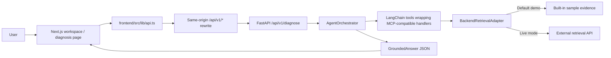

# EV Fault Diagnosis RAG

AI-assisted troubleshooting for electric two-wheelers. This repository contains the Next.js website, the FastAPI agent-orchestrator API, the MCP-compatible retrieval tools, and the scraper/vector-search code.

## Start a local demo

The local demo uses the orchestrator's built-in sample evidence. It does not require a model API key or a separate retrieval service. It verifies the website-to-agent flow, but it is not a live-corpus or repair-quality demonstration.

Use two terminals from the repository root.

**Terminal 1 — install and start the orchestrator:**

```sh
cd "Agent Orchestrator & MCP integration layer"
python3 -m venv .venv
.venv/bin/python -m pip install -r requirements.txt
HYBRID_RETRIEVAL_USE_MOCK=true \
DEFAULT_LLM_PROVIDER=ollama \
OLLAMA_BASE_URL=http://127.0.0.1:1 \
.venv/bin/python scripts/run_orchestrator_api.py
```

The unavailable local Ollama URL makes the demo use the orchestrator's deterministic retrieval fallback. To use a working LLM instead, configure a provider and its API key in this directory's ignored `.env` file, then start the API normally:

```sh
.venv/bin/python scripts/run_orchestrator_api.py
```

**Terminal 2 — install and start the website:**

```sh
cd frontend
npm ci
npm run dev
```

Open <http://127.0.0.1:3000>, enter a symptom, optionally select a vehicle and subsystem, and choose **Run AI Diagnosis**. The **System** page reports the API health, active tools, and whether retrieval is using sample data (`mock_domain_db`) or the configured live API. Stop either server with `Ctrl+C`.

If the orchestrator runs at a different address, set `ORCHESTRATOR_API_BASE_URL` before starting the Next.js development server. For a production build, set the same variable before both `npm run build` and `npm start`; Next.js bakes rewrites into its build configuration.

## How the UI and services connect



1. The home page collects the symptom and optional vehicle/subsystem, then navigates to `/diagnose` with those values. The diagnosis page sends a `QueryRequest` to the browser-facing helper in `frontend/src/lib/api.ts`.
2. The browser calls the same-origin `/api/v1/diagnose` URL. `frontend/next.config.mjs` rewrites it to the orchestrator at `http://127.0.0.1:8080` by default, avoiding browser CORS configuration. Override the target with `ORCHESTRATOR_API_BASE_URL`.
3. `Agent Orchestrator & MCP integration layer/src/api/routes.py` validates the request and calls `AgentOrchestrator.diagnose_fault`. The agent tries the configured LangChain chat model and can call retrieval, DTC, and component-spec tools.
4. In the website request path, those LangChain tools wrap the MCP-compatible handlers in the same process. The handlers call `BackendRetrievalAdapter`. The separately runnable MCP server is for MCP clients; it does not need to be started for the website's default local flow.
5. The adapter uses built-in sample records by default. In live mode it sends the query to the configured backend `/search` endpoint and includes the configured Bearer API key. The orchestrator combines the response and retrieved evidence into a `GroundedAnswer`.
6. The diagnosis page displays the returned fault hypotheses, Markdown analysis, procedure, remedy, warnings, grounding score, reasoning trace, and cited evidence. The evidence drawer shows the retrieved excerpt and source metadata.

The other pages use the same API rewrite: **DTC Lookup** calls `/api/v1/dtc/{code}`, **Knowledge Base** calls `/api/v1/eval-answers`, and **System** calls `/api/v1/health` and `/api/v1/mcp/tools`. It can also start the batch website-payload pipeline.

## Connect a live retrieval backend

The orchestrator has a live HTTP adapter, but this repository does **not** include a running retrieval HTTP service or a prepared chunk/vector corpus. The separate `scraper/vector_search` code is retrieval functionality, not an HTTP API by itself. A live service must implement the adapter's expected routes and response schema before switching off mock mode.

1. Copy `Agent Orchestrator & MCP integration layer/.env.example` to `.env` in that same directory. Keep `.env` private; it is ignored by Git. Set the active LLM provider/key, `HYBRID_RETRIEVAL_USE_MOCK=false`, `HYBRID_RETRIEVAL_API_BASE_URL` to the backend base path, and `HYBRID_RETRIEVAL_API_KEY`.
2. The adapter appends `/search` to `HYBRID_RETRIEVAL_API_BASE_URL` and sends `{query, vehicle_model, subsystem, top_k}`. It expects a JSON object with a `results` array whose entries match `EvidenceSource` in `src/common/models.py`.
3. DTC lookups use `/dtc/{code}` under the same base URL. Start the retrieval service, then the orchestrator, then the website. Confirm **System** reports `live_hybrid_api` and submit a query with known evidence.

If the configured retrieval service cannot be reached, the adapter logs the error and falls back to sample evidence. Treat such a response as mock output, not proof that live RAG is connected. The sample records and generated fallback are demonstration fixtures, not verified vehicle-specific service data; do not use their electrical measurements or procedures to repair a vehicle.

## Project map

| Path | Role |
| --- | --- |
| `frontend/` | Next.js App Router website and same-origin API rewrite |
| `Agent Orchestrator & MCP integration layer/src/api/` | FastAPI routes consumed by the website |
| `Agent Orchestrator & MCP integration layer/src/orchestrator/` | LLM tool-calling flow, grounding, and response synthesis |
| `Agent Orchestrator & MCP integration layer/src/mcp_server/` | MCP-compatible tools and live/mock retrieval adapter |
| `Agent Orchestrator & MCP integration layer/src/pipeline/` | Cleaning, summarization, formatting, and batch website payloads |
| `scraper/` | Source processing, chunk validation, embedding, and retrieval utilities |

## Checks

```sh
cd frontend
npm run build
cd "../Agent Orchestrator & MCP integration layer"
.venv/bin/python -m pytest -q
```

The orchestrator tests use sample data and mocked dependencies. A passing build or test suite does not verify live backend connectivity, source permissions, model availability, or diagnostic accuracy.
