# EV Fault Diagnosis RAG

AI-assisted troubleshooting for electric two-wheelers. The repository combines a Next.js website, a FastAPI backend gateway and retrieval API, a FastAPI agent orchestrator, and the existing scraper/vector-search code.

## Start the local demo

The demo runs the browser, backend gateway, and agent orchestrator as separate services. By default, the orchestrator uses clearly identified sample evidence; live vector retrieval requires a prepared corpus and a locally available embedding model. This checkout does not include those data/model assets.

From the repository root, install the Python dependencies once:

```sh
cd "Agent Orchestrator & MCP integration layer"
python3.12 -m venv .venv
.venv/bin/python -m pip install -r requirements.txt -r ../backend/requirements.txt
cd ..
```

The sample-data demo does not require `.env` files; the shell settings below select demo mode. **Terminal 1 — backend gateway:**

```sh
"Agent Orchestrator & MCP integration layer/.venv/bin/python" -m uvicorn backend.app:app --host 127.0.0.1 --port 8000
```

**Terminal 2 — orchestrator and explicit sample-data demo:**

```sh
cd "Agent Orchestrator & MCP integration layer"
HYBRID_RETRIEVAL_USE_MOCK=true \
DEFAULT_LLM_PROVIDER=ollama \
OLLAMA_BASE_URL=http://127.0.0.1:1 \
.venv/bin/python scripts/run_orchestrator_api.py
```

The unavailable Ollama URL makes the orchestrator use its deterministic demo synthesis. With a configured LLM provider, start the orchestrator without those provider overrides.

**Terminal 3 — website:**

```sh
cd frontend
npm ci
npm run dev
```

Open <http://127.0.0.1:3000>, enter a symptom, optionally select a vehicle and subsystem, and choose **Run AI Diagnosis**. Check <http://127.0.0.1:8000/health>: `retrieval_ready: false` means no live corpus is loaded; the gateway can still forward website requests. The **System** page reports the orchestrator's retrieval mode. Stop the services with `Ctrl+C`.

### Enable live corpus retrieval

1. Add authorized, validated JSONL chunks under `scraper/data/chunked/`, following the required fields in `scraper/vector_search/retrieval.py`.
2. Download `sentence-transformers/all-MiniLM-L6-v2` into the same user's Hugging Face model cache:
   ```sh
   "Agent Orchestrator & MCP integration layer/.venv/bin/python" -c 'from sentence_transformers import SentenceTransformer; SentenceTransformer("sentence-transformers/all-MiniLM-L6-v2")'
   ```
   The backend loads this model offline and builds/uses the ignored embedding cache on startup.
3. Copy both `.env.example` files to `.env` beside their examples. Set `HYBRID_RETRIEVAL_USE_MOCK=false` in the orchestrator `.env`. Set `BACKEND_API_KEY` in `backend/.env` to exactly the same secret as `HYBRID_RETRIEVAL_API_KEY` in the orchestrator `.env`. `.env` files contain local configuration/secrets and are ignored by Git; they are not needed for the demo.
4. Restart the backend and orchestrator, then confirm <http://127.0.0.1:8000/health> reports `retrieval_ready: true`.

If the corpus/model is missing or a live retrieval request fails, the API returns an explicit error; it does not substitute sample evidence. A production website build must use the same `BACKEND_API_BASE_URL` value at both `npm run build` and `npm start`, because Next.js bakes rewrites into its build configuration. Its default is `http://127.0.0.1:8000`.

## How the components connect

```mermaid
flowchart LR
  Person["User"] --> UI["Next.js diagnosis page"]
  UI --> Client["frontend/src/lib/api.ts"]
  Client --> Rewrite["Same-origin /api/v1/* rewrite"]
  Rewrite --> Gateway["Backend API gateway :8000"]
  Gateway -->|POST /api/v1/diagnose| AgentAPI["Orchestrator API :8080"]
  AgentAPI --> Agent["AgentOrchestrator"]
  Agent --> Tools["LangChain tools / MCP-compatible handlers"]
  Tools --> Adapter["BackendRetrievalAdapter"]
  Adapter -->|Demo mode only| Sample["Built-in sample evidence"]
  Adapter -->|Live mode| Retrieval["Backend /api/v1/retrieval/search"]
  Retrieval --> VectorSearch["scraper/vector_search Retriever"]
  VectorSearch --> Chunks["scraper/data/chunked/*.jsonl"]
  Agent --> Answer["GroundedAnswer JSON"]
  Answer --> Gateway
  Gateway --> UI
```



1. The home page collects a symptom and optional vehicle/subsystem, then opens `/diagnose`. That page sends a `QueryRequest` through `frontend/src/lib/api.ts`.
2. The browser calls same-origin `/api/v1/diagnose`. `frontend/next.config.mjs` rewrites it to the backend gateway at `http://127.0.0.1:8000`; set `BACKEND_API_BASE_URL` to change that destination.
3. `backend/app.py` forwards diagnosis requests to the orchestrator at `http://127.0.0.1:8080`. It also forwards the website's DTC, evaluation, system-health, and pipeline endpoints.
4. `Agent Orchestrator & MCP integration layer/src/api/routes.py` validates the request and calls `AgentOrchestrator.diagnose_fault`. LangChain tools wrap MCP-compatible handlers in the orchestrator process; the separate MCP server is only needed for external MCP clients.
5. `BackendRetrievalAdapter` uses sample records only when `HYBRID_RETRIEVAL_USE_MOCK=true`. Live mode calls the backend's authenticated `/api/v1/retrieval/search`; the endpoint searches JSONL chunks with the existing MiniLM embedder and cosine index. Returned results preserve chunk/source provenance and map to `EvidenceSource`.
6. The agent combines its answer with retrieved evidence into `GroundedAnswer`. The gateway returns the orchestrator response to the frontend, where the diagnosis page displays the analysis, procedure, warnings, grounding score, reasoning trace, and citations.

**DTC Lookup**, **Knowledge Base**, and **System** use the same gateway rewrite. The current adapter does not include a live DTC or component-spec database: live DTC lookups return not found when absent, and sample component specifications are disabled. The repository also has no prepared chunk corpus. Passing demo/tests does not prove live RAG readiness or diagnostic accuracy; sample repair measurements are not verified vehicle-specific service data.

## Project map

| Path | Role |
| --- | --- |
| `frontend/` | Next.js App Router website and same-origin backend rewrite |
| `backend/app.py` | FastAPI gateway and authenticated corpus retrieval API |
| `Agent Orchestrator & MCP integration layer/src/api/` | Orchestrator API routes |
| `Agent Orchestrator & MCP integration layer/src/orchestrator/` | LLM tool-calling flow, grounding, and response synthesis |
| `Agent Orchestrator & MCP integration layer/src/mcp_server/` | MCP-compatible tools and live/mock retrieval adapter |
| `Agent Orchestrator & MCP integration layer/src/pipeline/` | Cleaning, summarization, formatting, and batch website payloads |
| `scraper/` | Source processing, chunk validation, embedding, and retrieval utilities |

## Checks

```sh
PYTHONPATH=scraper/vector_search "Agent Orchestrator & MCP integration layer/.venv/bin/python" -m pytest -q backend/tests scraper/tests/test_retrieval.py
cd frontend
npm run build
cd "../Agent Orchestrator & MCP integration layer"
.venv/bin/python -m pytest -q
```

Tests use fixtures/mocks and do not require downloading the corpus or model. They verify the API contract and request flow, not live data availability, source permissions, or repair quality.
